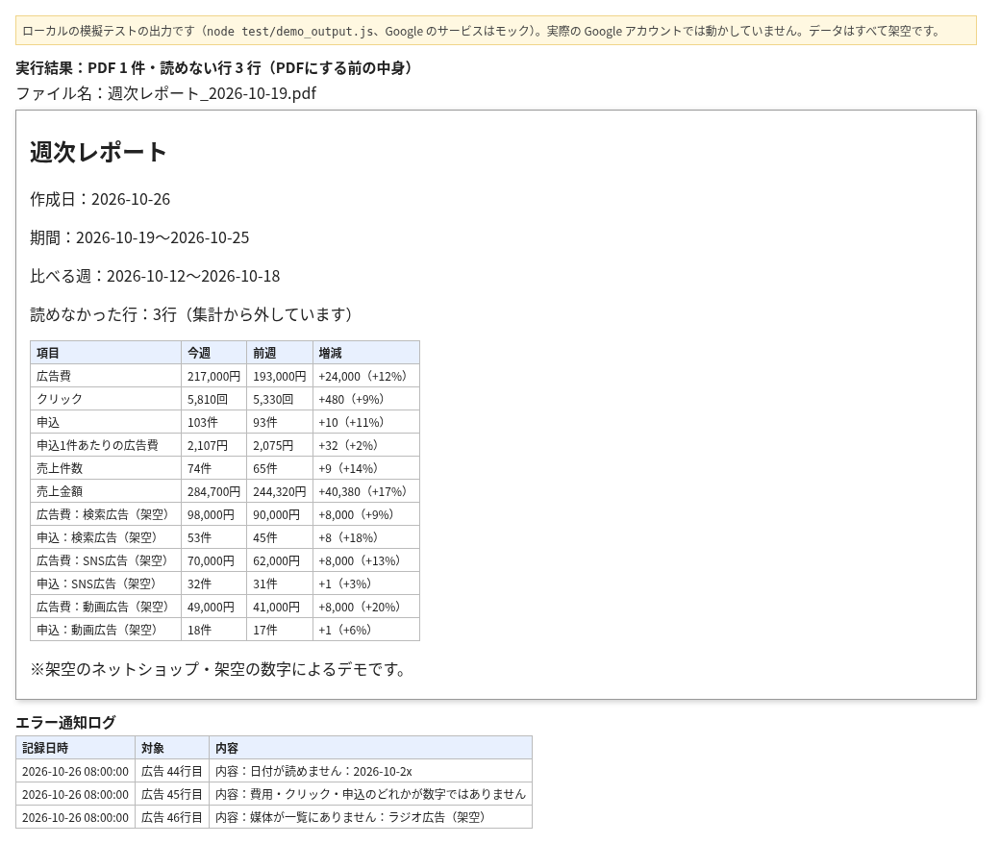

# 広告と売上の週次レポートを月曜の朝にPDFで作る（GAS見本）

ネットショップで、毎週の広告費・申込・売上を表にまとめてチームに出している担当の方向けです。

2026-10-26（月）に作った想定で、架空の先週分（2026-10-19〜2026-10-25）を前の週（2026-10-12〜2026-10-18）と比べた表を作り、読めない3行を集計から外してエラー通知ログに残した結果です。上の画像は、ローカルの模擬テスト（`node test/demo_output.js`、Google のサービスはモック）の実際の出力から作りました。実際の Google アカウントでは動かしていません。

**効果：** 毎週手で集計していた表が、月曜の朝8時台に自動でPDFになり、ドライブに保存されます。

架空の通販会社のデータで動きます。登場する会社・媒体・商品・宛先はすべて架空です。

## 課題
毎週、広告と売上の数字を集め、前の週のファイルを探して増減を手で計算していました。
入力の間違いに気づかないまま集計に入ることもありました。

## 仕組み
1. 「広告」「売上」シートから先週（月曜〜日曜）の分を集計
2. 「週次サマリー」に表を作る（広告費・クリック・申込・申込1件あたりの広告費・売上、媒体ごとの数字、前週との増減）
3. 同じ表をPDFにしてドライブのフォルダに保存
4. チームあての送信予定を「送信予定」シートに記録（送信はしない）
5. 毎週月曜8時台に自動で動く
6. 日付・数字・媒体が読めない行は集計から外し、「エラー通知ログ」に記録

## 効果
| | 作る前 | 作った後 |
|---|---|---|
| 週次レポートの作成 | 毎週手で集計 | 毎週月曜8時台に自動 |
| 前週との比較 | 手で計算 | 毎週同じ形で増減まで入る |
| 入力の間違い | 集計に入りやすい | 外して、どの行かを知らせる |

ローカルの模擬テスト（`node test/run.js`、Google のサービスはモック）で54件すべて通ることを確かめています。

## 画面
冒頭の画像は、PDFにする前の週次レポートの表（広告費・クリック・申込・売上の今週と前週、増減）と、集計から外した3行のエラー通知ログです。

## 設置の手順
1. 新しいスプレッドシートを作り、「拡張機能」から Apps Script を開く
2. src/ の .gs ファイルを同じ名前で作って中身を貼り付け、appsscript.json も置き換える
3. 「サービス」から Drive API（v3）を追加する
4. resetDemo を1回実行して架空のデータを入れ、makeDemoWeek で動きを確かめる
5. setupTriggers で毎週月曜のトリガーを作る。止めるときは stopTriggers

## 止まるときと記録
- その週のデータがないとき、シートがないとき、PDFにできないときは止めて記録します
- データがない週は「作成済み」にしないので、あとでデータを入れれば作れます

## ファイル
| ファイル | 役割 |
|---|---|
| src/Config.gs | シート名・見出し・媒体と商品の一覧・トリガーの曜日と時刻 |
| src/SeedData.gs | 架空の広告・売上（読めない行を含む） |
| src/Code.gs | 集計・表・PDF・送信予定・トリガー |
| src/Dedupe.gs | 作成済みの週の記録 |
| src/Pdf.gs・Notify.gs・Common.gs | PDF・通知文・共通の処理 |
| test/ | Node.js で動くテスト（demo_output.js は冒頭の画像の元になる出力） |

## 作りの工夫
- テスト：`node test/run.js`（Google のサービスを偽物に置き換えて Node.js で動かします。期待する合計は架空データから別に手で計算した数です）
- 二重処理の防ぎ方：「作成済みの週」シートに記録（src/Dedupe.gs、設定は src/Config.gs の dedupe）。makeWeekly から makeWeeklyLocked_ でロックを取って動かす
- 6分制限：1回の実行で作るのは1週分だけ。1日のPDFの上限は src/Config.gs の pdf.dailyLimit（src/Pdf.gs で確認）
- メールの権限は使わない（送信は記録だけ）

## 注意
- 架空のデータで動く見本です。実際の運用前に、自分の環境で動きを確かめてください
- Gmail・ドライブ・Apps Script には1日の上限があります

## 作った人
Reypage｜GAS業務自動化

## In English

A Google Apps Script sample that builds a weekly report from ad and sales sheets. All data is fictional (an online shop).
It totals last week (Monday to Sunday): ad spend, clicks, sign-ups, cost per sign-up, sales, per-channel figures and change from the week before.
The table is saved as a PDF in a Drive folder, and the planned team email is listed in a sheet without being sent. It runs on Mondays between 8 and 9 AM.
Rows with an unreadable date, number or channel are left out and written to an error log sheet.
How to try it:
1. Create a new spreadsheet and open Apps Script from Extensions.
2. Paste each `.gs` file in `src/`, replace `appsscript.json`, and add the Drive API (v3) service.
3. Run `resetDemo` to load sample data and `makeDemoWeek` to see the result. `setupTriggers` adds the Monday trigger (`stopTriggers` to stop).
4. Local tests with mocked Google services: `node test/run.js`. The image at the top is built from `node test/demo_output.js` on the same mocks. Not yet run in a real Apps Script project.

## ライセンス
MIT（LICENSE を参照）
